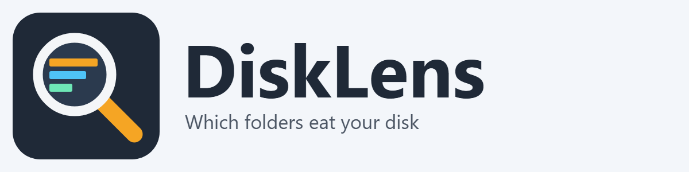

<p align="center">
  
</p>

<h1 align="center">DiskLens</h1>

<p align="center">
  <b>Показывает, что занимает место на диске сервера, прямо в чате или консоли.</b><br>
  Spigot · Paper · Purpur · Folia · Minecraft 1.16.5+
</p>

<p align="center">
  <a href="README.md">English version</a>
</p>

---

Многие панели хостинга не показывают размеры папок, а SSH часто нет. DiskLens сканирует папку сервера в фоне и показывает дерево, отсортированное по размеру, и самые большие файлы. Полный отчёт можно выгрузить в файл.

## Возможности

- **Дерево папок по размеру** с размерами, процентом от родительской папки и топ-N записей на уровень. Остальное сворачивается в `… ещё N (X ГБ)`.
- **Кликабельный вывод в чате:** папки можно нажимать, есть кнопки «вверх», «пересканировать» и «отчёт в файл».
- **Работает везде:** консоль сервера, консоль панели хостинга и RCON. Вывод в консоли — простой текст, дерево рисуется ASCII-символами и читается в любой панели.
- **Самые большие файлы** на всём сервере: `/disklens files`.
- **Полный отчёт** в `plugins/DiskLens/reports/` без ограничения по количеству строк.
- **Не блокирует сервер:** сканирование идёт асинхронно и не блокирует главный и региональные потоки. Результат хранится в кеше (по умолчанию 5 минут), `-r` запускает пересканирование.
- **Безопасно:** символьные ссылки и junction-папки не обходятся, папки без доступа пропускаются и считаются, выйти за пределы папки сервера нельзя (`..` отклоняется).
- **Языки:** английский и русский. Игроки видят язык своего клиента, можно добавить свой.
- **Конфиг обновляется сам:** новые опции добавляются вместе с комментариями, ваши значения не меняются, создаётся резервная копия `.bak`.
- **Совместимость с PlugMan / PlugManX:** выгрузка, загрузка и обновление без перезапуска.
- **Один jar для всех платформ:** на Folia используются её региональные и асинхронные планировщики.

## Установка

1. Скачайте `DiskLens-<версия>.jar` и положите в `plugins/`.
2. Перезапустите сервер или выполните `plugman load DiskLens-<версия>`.
3. Введите `/disklens` в игре (нужны права оператора) или `disklens` в консоли.

## Команды

| Команда | Описание |
|---|---|
| `/disklens` (алиас `/du`) | Дерево от корня сервера, глубина 2, топ-10 на уровень |
| `/disklens <путь> [глубина] [топN]` | Дерево от подпапки, например `/du world 3 15` |
| `/disklens files [N]` | Самые большие файлы сервера (по умолчанию 20) |
| `/disklens export [путь]` | Полный отчёт в `plugins/DiskLens/reports/report-<дата>.txt` |
| `/disklens status` | Состояние сканирования и кеша |
| `/disklens reload` | Перечитать `config.yml` и языки |
| `/disklens help` | Справка |
| `… -r` | Пересканировать, игнорируя кеш |

Папку с именем из одних цифр указывайте со слешем: `/du 2024/`.

**Право:** `disklens.use` (по умолчанию у операторов). Консоль и RCON имеют доступ всегда.

### Консоль, панели, RCON и командные блоки

- **Консоль:** вывод — простой текст. Начало сканирования, прогресс (каждые `progress-log-seconds` секунд) и завершение пишутся в лог сервера.
- **RCON и командные блоки** получают только то, что возвращается во время выполнения команды:
  - если кеш свежий, ответ приходит сразу;
  - иначе сканирование запускается в фоне, результат пишется в лог, а повтор команды через несколько секунд вернёт его сразу.

## Конфигурация

```yaml
config-version: 2          # не редактировать
language: auto             # для игроков: auto = язык клиента, или код (en, ru, ...)
default-language: en       # консоль/RCON и запасной язык (auto = язык системы)
command-aliases: [du]      # короткие команды, [] — отключить
cache-minutes: 5
default-depth: 2
default-top: 10
files-per-folder: 50       # сколько крупнейших файлов хранить в каждой папке, остальные → «N ещё»
largest-files: 100         # сколько крупнейших файлов сервера хранить для files и отчёта
max-chat-lines: 250
max-console-lines: 1000
console-ascii-tree: true   # +- \- | вместо ├─ └─ │ в консоли
report-ascii-tree: false
progress-log-seconds: 5
```

Переводы лежат в `plugins/DiskLens/lang/<код>.yml`. Чтобы добавить язык, скопируйте `en.yml` под новым кодом, переведите его и выполните `/disklens reload`. Недостающие ключи берутся из английского.

## PlugMan / PlugManX

```
plugman unload DiskLens
plugman load DiskLens-<версия>
```

На Folia перезагружайте через unload + load. В PlugManX 3.0.2 команда `plugman reload` падает с `UnsupportedOperationException` внутри самого PlugManX: он вызывает Bukkit-планировщик, которого на Folia нет.

## Что обычно занимает место

- тайлы карт (`bluemap/web/maps`, Dynmap);
- `world*/region`, особенно большой прегенер незера или Края;
- архивы бэкапов в корне сервера;
- `plugins/CoreProtect/database.db` (`co purge t:30d`);
- огромный `logs/latest.log`;
- профили и дампы `plugins/spark`.

## Сборка из исходников

Для сборки нужен JDK 21 (сам плагин — байткод Java 8 для ядра и Java 17 для моста Folia).

```bash
./gradlew build
```

Jar появится в `build/libs/`.

Интеграционные тесты запускают настоящие серверы нескольких ядер и версий:

```bash
python -I itest/run_matrix.py [фильтр]
```

Результаты пишутся в `itest/results/`.

## Лицензия

```
Copyright (c) 2026 ProjectENIUS
All Rights Reserved.

1. PERMITTED USE
- Server Usage: You may download and run the official compiled plugin binary (.jar) 
  on your Minecraft server(s) for personal or commercial server operation.
- Source Code Viewing: You may view and fork the source code solely for personal 
  educational purposes, reference, or submitting Pull Requests to the official repository.

2. RESTRICTIONS
Without prior written permission from the copyright holder, you may NOT:
- Copy, modify, or use any part of the source code in your own plugins, mods, or software.
- Compile and distribute your own builds (modified or unmodified) of this plugin.
- Redistribute, re-upload, sublicense, or sell the compiled binary or the source code 
  on any website, platform, or inside public modpacks/server setups.

3. CONTRIBUTIONS
Any Pull Requests or code contributions submitted to the official repository become 
subject to this same All Rights Reserved license, unless otherwise agreed in writing.

4. DISCLAIMER
THE SOFTWARE AND SOURCE CODE ARE PROVIDED "AS IS", WITHOUT WARRANTY OF ANY KIND, 
EXPRESS OR IMPLIED, INCLUDING BUT NOT LIMITED TO THE WARRANTIES OF MERCHANTABILITY, 
FITNESS FOR A PARTICULAR PURPOSE AND NONINFRINGEMENT. IN NO EVENT SHALL THE AUTHOR BE 
LIABLE FOR ANY CLAIM, DAMAGES OR OTHER LIABILITY ARISING FROM, OUT OF OR IN CONNECTION 
WITH THE SOFTWARE.
```

